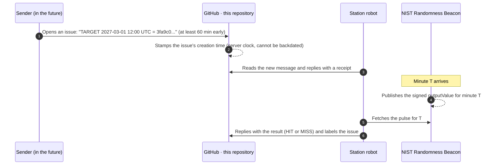
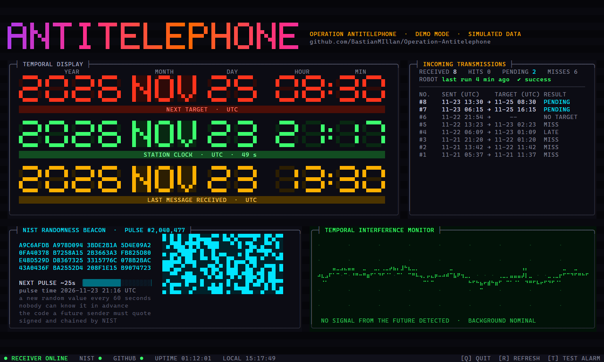

<p align="center">
  
</p>

<p align="center">
  <a href="https://github.com/BastianMIllan/Operation-Antitelephone/actions/workflows/robot.yml"></a>
  <a href="https://github.com/BastianMIllan/Operation-Antitelephone/actions/workflows/tests.yml"></a>
  <a href="https://github.com/BastianMIllan/Operation-Antitelephone/issues?q=is%3Aissue+-label%3A%22not+a+message%22"></a>
  <a href="https://github.com/BastianMIllan/Operation-Antitelephone/issues?q=label%3A%22station%3A+HIT%22"></a>
  <a href="RULES.md"></a>
  
  
  <a href="LICENSE"></a>
</p>

<p align="center">
  <b><a href="#send-a-message">Send a message</a></b> &nbsp;·&nbsp;
  <a href="#how-it-works">How it works</a> &nbsp;·&nbsp;
  <a href="#why-one-hit-would-be-proof">Why it would be proof</a> &nbsp;·&nbsp;
  <a href="#watch-it-live">Watch it live</a> &nbsp;·&nbsp;
  <a href="RULES.md">Rules</a> &nbsp;·&nbsp;
  <a href="#faq">FAQ</a>
</p>

---

## The idea in one minute

A message from the future can only reach us if a receiver is already switched on and waiting for it. You cannot travel to a time
before the machine was built, and you cannot call a phone that does not exist yet.

**Operation Antitelephone is that receiver.** In 1917 the physicist Richard Tolman showed that a signal faster than light could
work as an *antitelephone*: a line that delivers the answer before the call was made. Nobody has ever built the sending end.
This repository is the receiving end: a public, permanent line, open to anyone, with no end date.

The test is simple and impossible to fake:

1. Every 60 seconds, the [NIST Randomness Beacon](https://beacon.nist.gov) publishes a new 512-bit random code. Nobody can know
   it in advance.
2. Someone in the future can look up the code for a minute that is still ahead of *us*.
3. If they leave that code here **at least one hour before that minute**, GitHub's servers stamp the moment it arrived.
4. A robot checks every message automatically once the minute arrives.

A lucky guess succeeds **1 time in 18,446,744,073,709,551,616**. So a single correct message would be proof that information
travelled backwards in time.

> [!NOTE]
> Everything known about physics says no message will ever arrive. The station costs nothing to keep open, though, and if a single
> correct message ever arrives, nobody could argue with it. [Read the science](#the-science).

---

## How it works



| Part | What it does |
|---|---|
| **The inbox** | This repository's [issues](https://github.com/BastianMIllan/Operation-Antitelephone/issues). One issue is one message. GitHub records the exact time each one was created. |
| **The code** | The first 16 or more characters of the NIST beacon's `outputValue` for the target minute. |
| **The robot** | [`station.py`](station.py), run by GitHub Actions every hour and on every new message. It replies to each message, labels it, and closes finished ones. |
| **The rules** | [`RULES.md`](RULES.md), frozen forever. Its SHA-256 fingerprint is printed [below](#the-rules). |
| **The receiver** | [`receiver.py`](receiver.py), an optional live display that anyone can run on their own computer. |

---

## Send a message

You need a free GitHub account. Choose any target minute (UTC) at least one hour from now and send that minute's beacon code.
Of course, you can only know that code if you are writing from the future. Anyone else is welcome to try a guess.

### Option A: from a terminal

```bash
git clone https://github.com/BastianMIllan/Operation-Antitelephone
cd Operation-Antitelephone
python send.py          # on macOS and Linux: python3 send.py
```

The sender asks for the target minute and the code, checks both, and opens GitHub with the message filled in. You review it and
create the issue. If the GitHub CLI (`gh`) is installed and logged in, it can send the message straight from the terminal.

### Option B: a terminal in your browser (nothing to install)

Click **Code**, then **Codespaces**, then **Create codespace**. A terminal opens in your browser. Run `python send.py` and open
the link it prints.

### Option C: by hand

[Open a new issue](https://github.com/BastianMIllan/Operation-Antitelephone/issues/new/choose) and write one line:

```text
TARGET 2026-12-01 00:00 UTC = 0123456789abcdef
```

Use your own target minute (UTC), and at least the first 16 characters of that minute's beacon `outputValue`.

> [!IMPORTANT]
> **Never edit a message after sending it.** An edited message does not count. If you made a mistake, send a new one.
> **Recommended:** before the target minute, save your issue's page at [web.archive.org/save](https://web.archive.org/save) as
> independent proof.

---

## What the robot answers

The robot replies to every message twice. The first reply is a **receipt**: GitHub's timestamp, a fingerprint of your text, and
what it read. The second, once NIST has published the target minute, is the **result**.

| Result | Meaning |
|---|---|
| 🔴 **HIT** | Every character matches the beacon. A human then verifies it (see below). |
| ⚪ **Miss** | The code does not match. This is what physics predicts. |
| ⚪ **Too late** | Sent less than 60 minutes before its target. |
| ⚪ **Invalid** | Edited after sending, moved here from another repository, or more than one TARGET line. |
| ⚪ **Unreadable** | No TARGET line in the required format. |
| ⚪ **Void** | NIST skipped that minute (an outage). |
| 🔵 **Pending** | The target minute has not arrived yet. |
| 🟠 **Check by hand** | The message breaks a rule, but its code matches. A human must look at it. |

Finished messages are closed but stay public, so misses are never hidden.

---

## Why one hit would be proof

A hit needs three things to be true at once, and each is checkable by anyone:

1. **The code did not exist yet.** NIST's beacon combines hardware random-number generators into a new 512-bit value every
   minute. Each pulse is signed and chained to the previous one. Nobody outside NIST can know a value before it is published,
   about a minute after its timestamp.
2. **The message existed before the code did.** GitHub assigns every issue its creation time on its own servers, to the second.
   The sender cannot choose it. The robot also rejects edited messages and issues moved in from elsewhere.
3. **It was not luck.** Sixteen hexadecimal characters have 2⁶⁴ possible values. Even a billion spam guesses would have about
   one chance in 18 billion of producing a single lucky hit.

### Can it be faked?

The station is designed so that the people running it cannot fake a hit quietly. Its [rules](RULES.md) state the limits openly:

| Trusted party | What could go wrong | How it would show |
|---|---|---|
| **NIST** | NIST knows its own value about a minute ahead. | The 60-minute rule makes that useless. |
| **GitHub** | A repository admin can import or transfer issues with an earlier date. | Such issues are invalid under the rules. GitHub's public event archive ([gharchive.org](https://www.gharchive.org)), web archives and the robot's own reply times expose them. |
| **The keeper** | Deleting, hiding or editing messages. | The rules forbid it, and public archives and forks make it visible. |

---

## Verify anything yourself

You never have to trust the robot. Every result can be checked by hand:

```bash
python station.py verify 12              # judge message #12 from scratch
python station.py value 2026-11-23 06:00 # the beacon code for any past minute
python station.py hash RULES.md          # the rules' fingerprint
```

Or check it directly in a browser:

- **When a message was created:** `https://api.github.com/repos/BastianMIllan/Operation-Antitelephone/issues/<number>`, field `created_at`.
- **The beacon code for a minute:** `https://beacon.nist.gov/beacon/2.0/pulse/time/<milliseconds since 1970>`, field `outputValue`.

---

## Watch it live

<p align="center">
  
</p>

[`receiver.py`](receiver.py) is a live display for any computer. It shows:

- **Three glowing LED readouts:** the next target, the station clock and the last message received.
- **The NIST beacon live:** the code unscrambles as each new value arrives every minute.
- **A signal monitor** that turns red if a hit is ever reported.
- **The incoming messages** with their results.
- **A full-screen alarm with sound** if a hit is ever reported.

It only reads. It never sends anything.

```bash
python receiver.py           # Windows: double-click receiver.bat (full screen, restarts itself if it crashes)
python receiver.py --demo    # simulated messages, including a fake hit, to see everything working
python receiver.py --fps 2   # lighter on an always-on screen
```

| Key | Action |
|---|---|
| **Q** | Quit |
| **R** | Refresh now |
| **T** | Test the alarm |
| **A** | Acknowledge an alarm |

- **Window size:** the display grows with the window. From 108 × 28 characters it shows the LED panel. From 120 × 40 it adds
  the big title. From 206 × 52 (a full-screen 1080p monitor) the LEDs are double size.
- **Requirements:** Python 3.11 or newer, and a terminal with 24-bit colour (Windows Terminal, or most macOS and Linux
  terminals).
- **Sleep:** on Windows it keeps the PC awake while it runs (the screen can still turn off). Use `--allow-sleep` to turn that off.

---

## The science

**What would it take?** The only physical route to sending information into the past is a signal faster than light, or a
closed loop in spacetime. Relativity shows why: if a faster-than-light signal works the same way for every observer, two
observers moving relative to each other could relay a reply that arrives **before the original message was sent**. This is
Tolman's "tachyonic antitelephone" (1917). Every candidate mechanism fails a test:

- **Tachyons** (faster-than-light particles) have never been detected. The famous 2011 OPERA "faster-than-light neutrinos"
  turned out to be a loose cable.
- **Quantum entanglement** produces real correlations, but the no-signalling theorem proves it cannot carry a message.
- **Wormholes and warp drives** need exotic negative energy, and even in theory cannot reach a time before they were built.

**The receiver problem.** Even if one of these existed in the future, a message needs a receiver already in place in the past.
That is exactly what this station provides, and nothing more. It turns a philosophical question into a clean, public,
repeatable test.

**The tabletop experiment.** Before opening the station, its keeper ran a small pre-registered experiment on an ordinary PC.
One program signalled to another through CPU load alone, and the test checked both directions in time:

| Direction | Result |
|---|---|
| **Forward** (bit sent → read later) | 1,999 of 2,000 bits received correctly |
| **Backward** (reading saved → bit created later) | 49–52% correct: coin flips, no signal |

The full write-up is in [docs/EXPERIMENT.md](docs/EXPERIMENT.md).

---

## The rules

The rules are in [RULES.md](RULES.md). They define exactly what counts as a message, a hit and a miss. They are **frozen
forever**: any change would show up in the repository's history. Their SHA-256 fingerprint is:

```text
9df6a0dd623f2e04ca244afc366fc3d582a2f9cafbcd36515317aa1cddd446f7
```

Check it yourself with `python station.py hash RULES.md`.

---

## Repository layout

| Path | Purpose |
|---|---|
| [`RULES.md`](RULES.md) | The frozen rules: what counts as a message, a hit and a miss |
| [`send.py`](send.py) | Sender: asks for the target and the code, then opens a pre-filled message |
| [`station.py`](station.py) | The robot (run by GitHub Actions) and the `verify` / `value` / `hash` tools |
| [`receiver.py`](receiver.py) · [`receiver.bat`](receiver.bat) | The live terminal display, and its full-screen Windows launcher |
| [`.github/workflows/robot.yml`](.github/workflows/robot.yml) | Runs the robot every hour and on every new message |
| [`.github/workflows/keepalive.yml`](.github/workflows/keepalive.yml) | Stops GitHub from pausing the hourly robot in a quiet repository |
| [`.github/workflows/tests.yml`](.github/workflows/tests.yml) | Runs the test suite on Windows and Linux for every change |
| [`tools/make_banner.py`](tools/make_banner.py) | Generates the banner at the top of this page, as code |
| [`tools/make_preview.py`](tools/make_preview.py) | Generates the receiver screenshot above, from the real program |
| [`tests/`](tests) | Offline test suite: `python -m unittest discover tests` |
| [`docs/EXPERIMENT.md`](docs/EXPERIMENT.md) | The pre-registered tabletop experiment and its results |

Everything uses only Python's standard library. There is nothing to install.

---

## FAQ

<details>
<summary><b>Is this serious?</b></summary>

It is a serious test of a question that sounds like a joke. The design is the same as a real scientific experiment: the method
and success criteria are fixed in advance, every result is public, and anyone can verify anything. The expected outcome is
silence. Silence is also a result.
</details>

<details>
<summary><b>Why NIST, and why GitHub?</b></summary>

NIST's beacon is a public, signed, minute-by-minute random number designed for exactly this kind of proof: nobody can know it
early. GitHub records the creation time of every issue on its own servers, keeps edit histories, and is archived publicly. That
makes it a good always-on receiver that nobody, including the keeper, can backdate quietly.
</details>

<details>
<summary><b>Can I send a message just for fun?</b></summary>

Yes. Every message gets an honest answer from the robot. Misses are part of the record.
</details>

<details>
<summary><b>What happens if NIST or GitHub changes something in the future?</b></summary>

The rules cover it. If NIST skips a minute, the attempt is void. If the beacon address stops serving new pulses for a year,
targets after its last pulse are void. If GitHub changes, the rules name the exact repository and the evidence to check.
</details>

<details>
<summary><b>Can I run my own station?</b></summary>

Yes. Fork the repository, put your own repository name in `station.json` and in the `if:` lines of the two workflow files,
write your own rules with your repository's name, and publish their fingerprint. Messages sent to a fork do not count for
this station.
</details>

<details>
<summary><b>What if a hit actually happens?</b></summary>

The robot labels it **HIT**, and the receiver raises its alarm. Then humans verify it independently, using the steps in
[RULES.md](RULES.md), before anyone announces anything.
</details>

---

<p align="center">
  <sub>Built with Python's standard library, the <a href="https://beacon.nist.gov">NIST Randomness Beacon</a> and GitHub Actions.
  Released under the <a href="LICENSE">MIT license</a>.<br>The line is open. Listening since the first commit.</sub>
</p>
